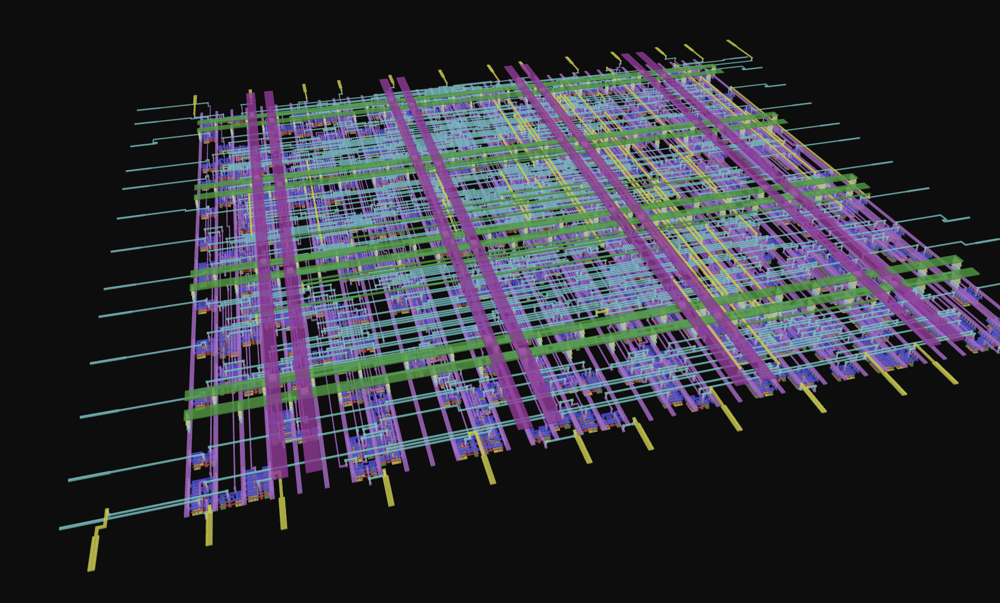
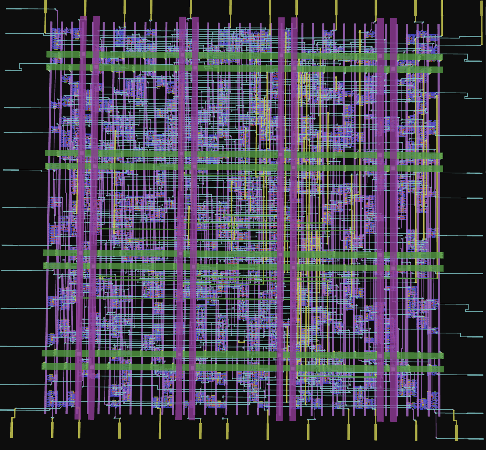
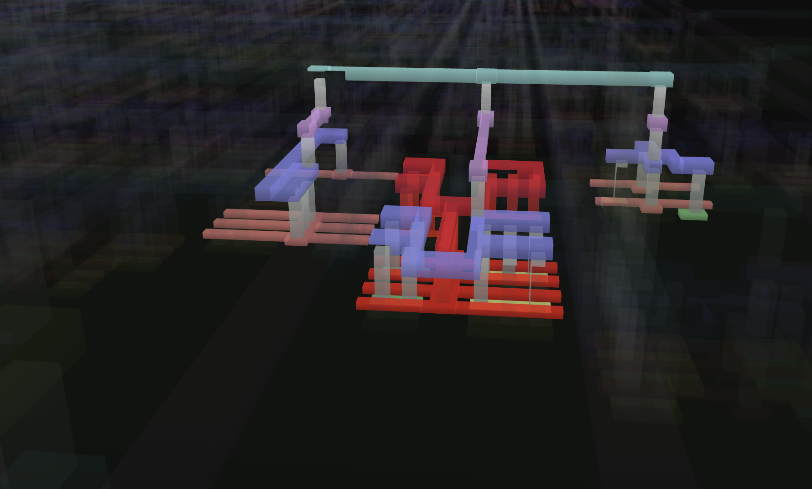

# Flux-16: 16-bit ALU, verified in simulation and hardened on SKY130

Flux-16 is a combinational 16-bit ALU with eight operations and four status flags. This repository contains two pieces of work on it:

1. **Functional verification** of the RTL: a self-checking testbench with a reference model, flag invariants, flag coverage bins, and a fault-injection script that checks whether the testbench can actually detect bugs.
2. **Physical implementation** of an earlier revision of the RTL through the OpenLane RTL-to-GDSII flow on the open-source SkyWater 130 nm PDK.

## Status at a glance

| Item | Result |
| --- | --- |
| Current RTL (`src/alu.v`) vs. reference model | 10,896 vectors, 0 mismatches, 0 invariant violations |
| Flag coverage | 19 of 19 reachable flag bins hit |
| Fault injection | 12 of 12 hand-written faults detected |
| Layout (earlier RTL revision, see note) | Magic DRC 0, Netgen LVS 0 errors, 0 antenna violations |
| Timing of the layout, typical corner | 4.58 ns critical path, +1.17 ns setup slack against a 10 ns virtual clock |

> **The layout and the verified RTL are different revisions.** The GDS and every file in `reports/` come from an OpenLane run on 2026-09-30 using the first version of the ALU (commit `bcbf13b`: 16-bit result plus a `zero` flag, unsigned SLT). I later added the `neg`, `overflow`, and `carry` flags, changed SLT to a signed comparison, and wrote the testbench against that newer RTL. The newer RTL has not been re-run through the flow, and the first version was never run against this testbench. The two halves of this README should be read with that in mind.

## The design

`alu` is purely combinational: 35 input bits (`a[15:0]`, `b[15:0]`, `alu_op[2:0]`), a 16-bit result, and four flags. There is no clock, reset, or state.

| `alu_op` | Operation | Result | `carry` | `overflow` |
| --- | --- | --- | --- | --- |
| `000` | ADD | `a + b` | carry out of bit 15 | signed overflow |
| `001` | SUB | `a - b` | borrow (1 when `a < b` unsigned) | signed overflow |
| `010` | AND | `a & b` | 0 | 0 |
| `011` | OR | `a \| b` | 0 | 0 |
| `100` | XOR | `a ^ b` | 0 | 0 |
| `101` | SLL | `a << b[3:0]` | 0 | 0 |
| `110` | SRL | `a >> b[3:0]` | 0 | 0 |
| `111` | SLT | 1 if `a < b` signed, else 0 | 0 | 0 |

For every operation, `zero` is 1 when the result is `0x0000` and `neg` is bit 15 of the result.

## Verification

### Testbench architecture (`src/tb_alu.v`)

The testbench is plain Verilog, simulated with Icarus Verilog. Every vector goes through the same `run_test` task, which drives the inputs, waits 10 ns, and applies four kinds of checks.

**Reference model.** A separate task computes the expected result and flags. For the arithmetic flags it uses a different derivation from the RTL, so that a shared misunderstanding is less likely to hide a bug:

| Flag | RTL computes it as | Reference model computes it as |
| --- | --- | --- |
| ADD/SUB `overflow` | sign-bit rule on operands and result | sign-extend to 32 bits, do the arithmetic, check whether the result is outside −32768…32767 |
| ADD `carry` | bit 16 of a 17-bit sum | 32-bit unsigned sum ≥ 65536 |
| SUB `carry` | bit 16 of a 17-bit difference | unsigned comparison `a < b` |
| SLT | `$signed(a) < $signed(b)` | comparison of manually sign-extended integers |

**Flag invariants.** Three properties are checked directly on the DUT outputs, without using the reference model: `zero` agrees with `out == 0`, `neg` agrees with `out[15]`, and `carry`/`overflow` are 0 for every non-arithmetic opcode.

**X/Z guards.** A reduction-XOR check flags any unknown bit on the stimulus or on the DUT outputs.

**Flag coverage bins.** For each opcode, the testbench records whether each flag was ever observed high. Only reachable bins are counted: `zero` for all 8 opcodes, `neg` for 7 (SLT can only return 0 or 1), and `overflow` and `carry` for ADD and SUB. That gives 19 bins. A run fails if any bin is empty, so a passing run cannot come from stimulus that never exercised a flag.

### Stimulus

| Phase | What it does | Vectors |
| --- | --- | --- |
| 1. Corner cross | 10 corner values (`0000`, `0001`, `0002`, `7FFE`, `7FFF`, `8000`, `8001`, `FFFE`, `FFFF`, `5555`) for `a` × the same 10 for `b` × all 8 opcodes | 800 |
| 2. Shift sweep | Shift amounts 0–15 for SLL and SRL on three patterns (`0001`, `A5A5`, `8001`) | 96 |
| 3. Constrained random | Random opcode; each operand independently has a 30% chance of being a corner value, otherwise fully random | 10,000 |
| | **Total** | **10,896** |

### Results on the current RTL

Run with Icarus Verilog 12.0:

```
Reachable flag bins covered: 19 / 19
Total Vectors Executed : 10896
Input X/Z Faults       : 0
Functional Mismatches  : 0
Invariant Violations   : 0
Flag-bin Coverage Holes: 0
STATUS                 : PASSED
```

### Fault injection (`src/run_mutants.py`)

A testbench that passes says little unless it can also fail. The script makes one textual change to a copy of `alu.v` at a time, re-runs the full testbench, and records whether any check fires. The original file is never modified. A fault counts as detected only if it causes a reference-model mismatch, an invariant violation, or an X fault; an empty coverage bin alone does not count.

| Injected fault | Result | Failing vectors (of 10,896) |
| --- | --- | --- |
| ADD carry stuck at 0 | Caught | 588 |
| ADD overflow ignores sign match | Caught | 342 |
| SUB carry inverted | Caught | 1,301 |
| SUB overflow uses wrong sign test | Caught | 668 |
| AND replaced by OR | Caught | 1,335 |
| XOR replaced by OR | Caught | 1,102 |
| SLL uses `b[2:0]` | Caught | 589 |
| SRL uses `b[2:0]` | Caught | 596 |
| SLL wrong only at shift amount 15 | Caught | 76 |
| SLT unsigned instead of signed | Caught | 656 |
| `neg` flag stuck at 0 | Caught | 4,082 |
| `zero` flag inverted | Caught | 10,896 |

All 12 faults are detected. The two flag faults at the bottom are caught by both the reference model and the invariants. The narrowest fault, which only misbehaves at shift amount 15, is still hit by 76 vectors, mostly because of the directed shift sweep and the corner-biased operands.

### What this verification does and does not show

- **It is sampling, not proof.** The input space is 2^35 ≈ 3.4 × 10^10 combinations; 10,896 vectors is a very small fraction. The testbench shows agreement with the reference model on corner values and a random sample, not on all inputs.
- **The reference model is not fully independent.** I wrote both it and the RTL, in the same language. The arithmetic flags and SLT are derived differently, but AND, OR, XOR, and the shifts use the same Verilog operators in both, so a misreading of the specification for those would pass unnoticed.
- **Coverage is narrow.** The 19 bins record only "flag seen high per opcode". There is no RTL code coverage (line, branch, toggle) and no cross coverage of operand classes.
- **The fault list is small and hand-picked.** I chose the 12 faults myself, so 12 of 12 is evidence that the checks work for the bug classes I thought of. It is not a mutation score from an automated tool.
- **One random seed.** Phase 3 uses `$urandom` with the simulator's default seed, which makes runs repeatable but means only one random sequence has been tried. The per-fault counts above depend on that sequence and on the simulator version.
- **RTL only.** No gate-level simulation was run on either the synthesized or the post-layout netlist.

## Physical implementation

### What was run

The first RTL revision was taken through OpenLane with the `sky130_fd_sc_hd` standard-cell library (`config.json`): synthesis with the `AREA 0` strategy, floorplanning at a 40% core-utilization target, power-grid generation, placement at 0.45 target density, global and detailed routing, parasitic extraction, static timing analysis, and physical signoff checks. The whole flow completed in 58 seconds.

Because the design has no flip-flops and no clock port, clock tree synthesis was disabled (`RUN_CTS: 0`) and the skew report is empty. Timing is constrained against a virtual clock instead.

### Layout

| 3D render | Die view | Standard-cell view |
| :---: | :---: | :---: |
|  |  |  |

*Rendered with [Tiny Tapeout Explorer](https://znah.net/tiny_explorer/) from `results/alu.gds`.*

### Results

All values are taken from `reports/metrics.csv` and the report files named in the last column.

| Category | Metric | Value | Source |
| --- | --- | --- | --- |
| Area | Die area | 0.0138 mm² (13,815 µm²) | `metrics.csv` |
| | Core area | 10,185 µm² | `metrics.csv` |
| | Placement utilization | 42.1% (40% target) | `metrics.csv` |
| Cells | Logic cells after synthesis | 424 | `metrics.csv` |
| | Logic and buffer cells after place and route | 485 | `metrics.csv` |
| | Total placed instances | 1,425 (485 logic/buffer, 578 decap, 136 well tap, 226 fill) | `metrics.csv` |
| Routing | Wire length / vias | 17,275 µm / 3,916 | `metrics.csv` |
| | Detailed-routing violations | 0 | `metrics.csv` |
| Timing | Critical path delay | 4.58 ns, `a[14]` → `zero` | `29-rcx_sta.max.rpt` |
| | Worst setup slack | +1.17 ns | `29-rcx_sta.summary.rpt` |
| | Worst hold slack | +4.41 ns | `29-rcx_sta.summary.rpt` |
| | Max slew / cap / fanout violations | 0 / 0 / 0 | `29-rcx_sta.checks.rpt` |
| Power | Total | 261 µW (107 µW internal, 154 µW switching, 3 nW leakage) | `29-rcx_sta.power.rpt` |
| IR drop | Worst static drop | 0.14 mV on VPWR, 0.12 mV rise on VGND | `30-irdrop-*.rpt` |
| Signoff | Magic DRC | 0 violations | `drc.rpt` |
| | Netgen LVS | 0 errors | `37-alu.lvs.rpt` |
| | Antenna | 0 violations, 0 diodes inserted | `39-antenna_violators.rpt` |
| | Magic vs. KLayout GDS XOR | 0 differences | `33-xor.rpt` |

### How to read the timing and power numbers

- **Timing constraints.** The STA reports show a 10 ns virtual clock, 2 ns of external delay on every input and every output, and 0.25 ns of clock uncertainty. That leaves 5.75 ns for the logic. The longest path, from `a[14]` through the result logic and the zero-detect OR tree to `zero`, takes 4.58 ns, which gives the 1.17 ns of slack. Since the block is combinational, the meaningful number is the 4.58 ns propagation delay; the slack depends on the I/O budget I assumed.
- **Hold slack** is reported for completeness. With no registers inside the block, it reflects only the assumed I/O delays.
- **Parasitics.** Timing and power are post-route, using extracted parasitics. STA reports no unannotated nets.
- **Single corner.** Everything is at the typical corner only. Slow and fast corners were not analyzed, so this is not a multi-corner timing closure.
- **Power** is OpenSTA's estimate with the tool's default switching activity. No simulation activity file was supplied, so 261 µW is a rough figure and not a workload measurement.

### Signoff checks that were not completed

- **CVC (circuit validity check)** started but did not finish; `reports/alu.rpt` stops after netlist parsing and `metrics.csv` records no result for it.
- **KLayout DRC** was not run. DRC cleanliness rests on Magic alone; `drc.klayout.xml` is Magic's result converted to KLayout's report format.
- The design has not been submitted for fabrication.

## Repository layout

```
src/alu.v             Current RTL (8 operations, 4 flags)
src/tb_alu.v          Self-checking testbench
src/run_mutants.py    Fault-injection script
config.json           OpenLane configuration
reports/              STA, power, IR drop, DRC, LVS, antenna, and XOR reports (first RTL revision)
results/alu.gds       Final layout (first RTL revision)
asset/                Layout renders
```

## Reproducing the results

Verification needs Icarus Verilog and Python 3:

```bash
cd src
iverilog -g2012 -o sim alu.v tb_alu.v && vvp sim   # testbench on the unmodified RTL
python3 run_mutants.py                              # fault injection; writes mutation_results.md
```

The layout was produced with OpenLane 1.x by placing this repository at `designs/alu` and running `./flow.tcl -design alu`. Note that `config.json` references `src/alu.sdc`, which is not yet committed here; the constraints the run actually used are listed in the timing notes above.

## Known gaps and next steps

1. **Re-harden the current RTL** so that the layout, reports, and verified design are the same revision, and add `src/alu.sdc` to the repository.
2. **Gate-level simulation**: run the same testbench on the post-layout netlist to check that the implemented design matches the RTL.
3. **Formal verification**: the ALU is small and combinational, so the flag properties and equivalence to a specification model can be proved for all 2^35 inputs with SymbiYosys, replacing sampling with proof.
4. **Stronger coverage**: add code coverage, cross coverage of operand classes per opcode, and multiple random seeds.
5. **Automated mutation testing** in place of the hand-written fault list.
6. **Multi-corner timing** at the slow and fast corners, and a completed CVC run.